  

  

---

### ✦ Featured Projects

| Project | Stack | Description |
| :--- | :--- | :--- |
| [**Glimpse**](https://github.com/xVegetax/Glimpse) | `Rust` · `Tauri v2` · `TypeScript` | Fast, lightweight screen capture, vector/pixel annotation studio, offline Windows OCR, local QR mobile share, and 60 FPS MP4 recording for Windows. |
| [**Vice-City-Menu-For-Fivem**](https://github.com/xVegetax/Vice-City-Menu-For-Fivem) | `CSS` · `HTML` · `Lua` | Custom retro Vice City pause menu interface designed for FiveM servers. |

---

### 🛠️ Tech Stack & Tools

  
  
  
  
  
  
  
  
  

